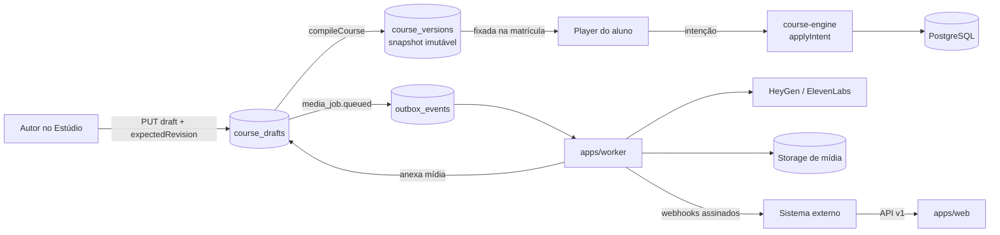

# Visão geral

Monólito modular em TypeScript com dois processos: **web** (Next.js: estúdio, portal do aluno e rotas HTTP) e **worker** (jobs em segundo plano). Um PostgreSQL guarda os dados e os documentos JSONB versionados.

## Ideias centrais

- Editor e player usam o mesmo contrato: `@lms/course-schema`. Veja [[Monorepo e pacotes]].
- O motor é uma função pura. O servidor é a autoridade e grava estado e evento na mesma transação.
- Publicar é explícito e cria um snapshot imutável. Aluno em andamento fica na versão fixada.
- Prévia e portal rodam o mesmo motor e o mesmo componente `LessonPlayer`.
- O agente de IA só propõe. Quem aplica é o backend, com validação e nova revisão.
- Nenhum provedor pago roda sem `ALLOW_PAID_PROVIDERS`. Veja [[Geração de mídia, orçamento e teto diário]].

## Concorrência

- Rascunho: `course_drafts.revision` com `expectedRevision`. Conflito devolve 409.
- Tentativa do aluno: `SELECT ... FOR UPDATE` e evento idempotente por `(attempt_id, event_id)`.
- Outbox: gravado na mesma transação, com tentativas limitadas. Nenhuma transação fica aberta durante chamada externa.

## Para onde ir

[[Banco e migrações]] · [[Worker e fila]] · [[Portal do aluno e Estúdio]] · [[Segurança, acesso e login]] · [[Implantação]]
