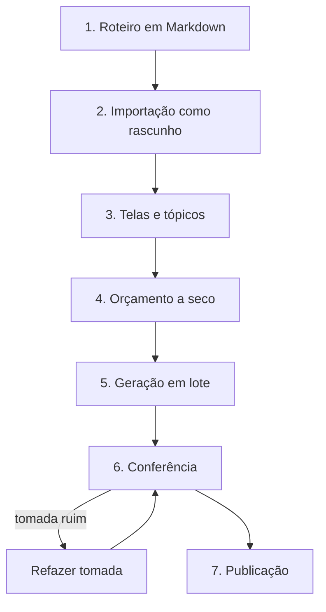

# Fluxo de ponta a ponta

Como um curso vai do roteiro ao aluno, no modelo atual do piloto (sem gravação humana).

## Passos

1. **Roteiro.** Escrito em `docs/roteiros/<curso>.md`. Ver [[Sintaxe do roteiro Markdown]].
2. **Importação.** `import-markdown-course.ts` cria ou atualiza o rascunho com um kit. Nada é gerado nem pago. Ver [[Importador (CLI e flags)]] e [[Kits, estúdios e instrutores]].
3. **Telas e tópicos.** Arquivos `telas/<curso>.telas.md` e `telas/<curso>.topicos.md` ao lado do roteiro. Ver [[Telas simuladas]] e [[Tópicos do painel]].
4. **Orçamento.** `gerar-curso.ts` sem `--confirmar` calcula e imprime o custo, sem gravar. Ver [[Geração de mídia, orçamento e teto diário]].
5. **Geração.** Com `--confirmar` e `ALLOW_PAID_PROVIDERS=1`, o script só enfileira. Quem chama os provedores é o worker. Ver [[Worker e fila]].
6. **Conferência.** O painel de pulsos mostra as mãos de cada tomada. Tomada ruim volta pelo `refazer-tomadas`. Ver [[Conferência de qualidade]].
7. **Publicação.** O compilador bloqueia erros e publica um snapshot imutável. Ver [[Visão geral]].

## Regras que valem sempre

- Primeiro a seco, depois `--confirmar`.
- Um lado por cena. Ver [[2026-11-13 Um lado por cena]].
- Não publicar política ou termos sem revisão jurídica. Ver [[2026-11-13 Política, termos e certificado adiados]].

> [!info] Onde isto vive no piloto
> C1 está em produção no Mac local. C2 a C5 estão importados como rascunho. Ver [[Cursos C1 a C5]].
